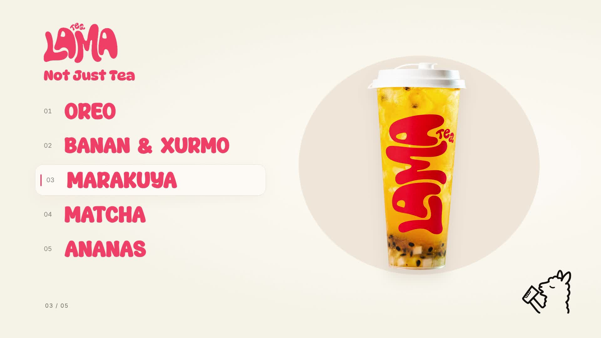

# LAMA · Bubble Tea

Sutrang fonda beshta ta’mni namoyish qiluvchi animatsiya: **11,5 soniya · 1920×1080 · 30 fps**.
Chapdagi ta’m nomi ajratilganda o‘ngda mos ichimlik chiqadi. Logo va maskot ham sahnada qatnashadi.

**[MP4 videoni yuklab olish](lama-motion.mp4)**

[Yakuniy kadrni ko‘rish](lama-motion-ending.jpg)

Ichimliklar va maskot shaffof PNG’lardan joylashtirilgan.
[Oltita shaffof PNG’ni yuklab olish](lama-transparent-pngs.zip).

Ta’mlar: OREO, BANAN & XURMO, MARAKUYA, MATCHA, ANANAS.

Ta’m nomlari: **Bubbly Humble**, logo rangida (`#FF5266`). Shior **DynaPuff Bold**
shriftida aynan **Not Just Tea** ko‘rinishida yozilgan. Video yakunida LAMA logosi
pastga tushib, shiorning tepasida joylashadi.

- [Animatsiya manbasi](lama-motion/index.html)
- [Ssenariy va qayta render qilish](lama-motion/README.md)
- [Asos bo‘lgan skill](.agents/skills/bs-launchmotion-type-demonstrate-parameter-system/SKILL.md)

Video ovozsiz. Rasmlar, logo va maskot foydalanuvchi yuborgan materiallar asosida tayyorlangan;
ichimliklar va maskotning foni ImageGen yordamida olib tashlangan.
Uchinchi tomon kutubxonalari va shrift haqidagi ma’lumotlar [bu yerda](lama-motion/THIRD_PARTY_NOTICES.md).
